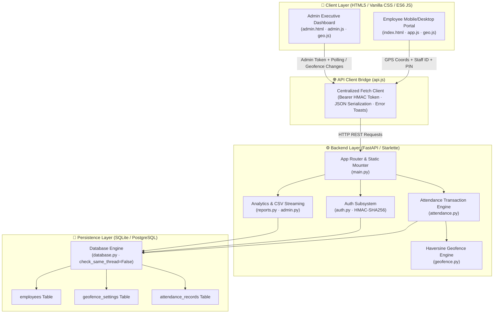
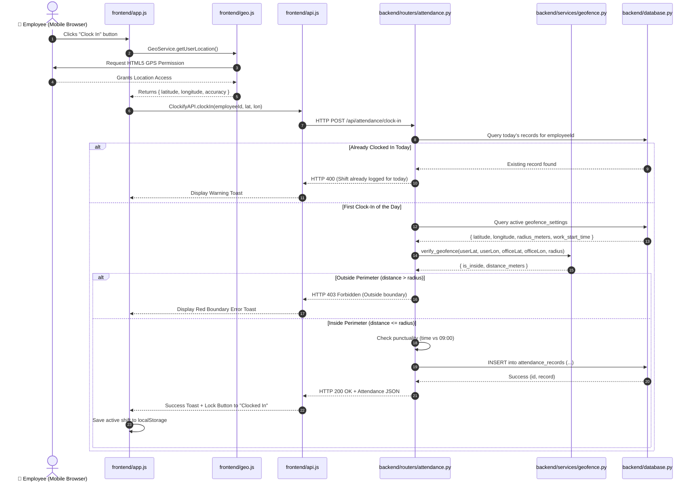
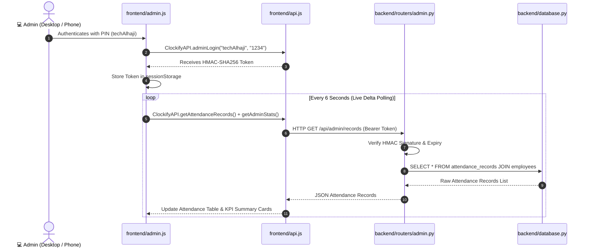
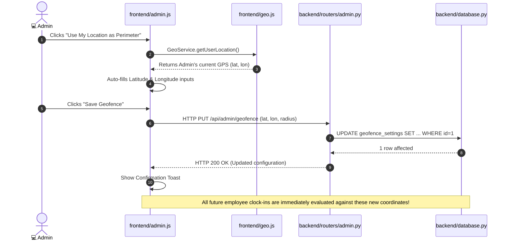

# 📖 Clockify — Complete System Architecture & Codebase Guide

> **Project Name:** Clockify — Geofence-Verified Smart Attendance Management System  
> **Repository:** `techAlhaji/Clockify`  
> **Team Size:** 9 Members  
> **Core Tech Stack:** Python 3.10+ (FastAPI), HTML5 / Vanilla CSS3 / Modern ES6 JavaScript, SQLite3 / PostgreSQL (`pg8000`), Vercel Serverless & Local Uvicorn  

---

## 📌 Table of Contents
1. [Executive Summary & Core Objectives](#1-executive-summary--core-objectives)
2. [High-Level System Architecture](#2-high-level-system-architecture)
3. [Frontend Deep Dive — How It Works & How It Was Built](#3-frontend-deep-dive--how-it-works--how-it-was-built)
   - [3.1 Structure & UI Design System (`index.html`, `style.css`)](#31-structure--ui-design-system-indexhtml-stylecss)
   - [3.2 Geolocation & Proximity Engine (`geo.js`)](#32-geolocation--proximity-engine-geojs)
   - [3.3 Client API Integration & HTTP Client (`api.js`)](#33-client-api-integration--http-client-apijs)
   - [3.4 Employee Portal Controller & Shift Lock (`app.js`)](#34-employee-portal-controller--shift-lock-appjs)
   - [3.5 Admin Dashboard & Live Multi-Device Console (`admin.html`, `admin.css`, `admin.js`)](#35-admin-dashboard--live-multi-device-console-adminhtml-admincss-adminjs)
   - [3.6 Mobile Responsiveness Implementation](#36-mobile-responsiveness-implementation)
4. [Backend Deep Dive — How It Works & How It Was Built](#4-backend-deep-dive--how-it-works--how-it-was-built)
   - [4.1 Server Entry Point & Lifecycle (`run.py`, `backend/main.py`)](#41-server-entry-point--lifecycle-runpy-backendmainpy)
   - [4.2 Configuration, Environment & Timezones (`backend/config.py`)](#42-configuration-environment--timezones-backendconfigpy)
   - [4.3 Security, PINs & Stateless HMAC Tokens (`backend/routers/auth.py`, `backend/schemas.py`)](#43-security-pins--stateless-hmac-tokens-backendroutersauthpy-backendschemaspy)
   - [4.4 Geofence Math & Haversine Formula (`backend/services/geofence.py`)](#44-geofence-math--haversine-formula-backendservicesgeofencepy)
   - [4.5 Attendance Transaction Engine (`backend/routers/attendance.py`)](#45-attendance-transaction-engine-backendroutersattendancepy)
   - [4.6 Admin Analytics & CSV Export Engine (`backend/services/reports.py`, `backend/routers/admin.py`)](#46-admin-analytics--csv-export-engine-backendservicesreportspy-backendroutersadminpy)
   - [4.7 Employee Directory Management (`backend/routers/employees.py`)](#47-employee-directory-management-backendroutersemployeespy)
5. [Database Architecture — Schema, Models & Data Persistence](#5-database-architecture--schema-models--data-persistence)
   - [5.1 Relational Schema & Tables (`backend/database.py`, `backend/models.py`)](#51-relational-schema--tables-backenddatabasepy-backendmodelspy)
   - [5.2 Serverless Persistence & Thread Safety](#52-serverless-persistence--thread-safety)
   - [5.3 Dual-Engine Support (SQLite3 + PostgreSQL / Neon `pg8000`)](#53-dual-engine-support-sqlite3--postgresql--neon-pg8000)
6. [How the Layers Connect End-to-End](#6-how-the-layers-connect-end-to-end)
   - [6.1 Employee Clock-In Flow (End-to-End)](#61-employee-clock-in-flow-end-to-end)
   - [6.2 Real-Time Admin Multi-Device Sync Flow](#62-real-time-admin-multi-device-sync-flow)
   - [6.3 Dynamic Geofence Perimeter Reconfiguration Flow](#63-dynamic-geofence-perimeter-reconfiguration-flow)
7. [Team Attribution Matrix — Who Built What](#7-team-attribution-matrix--who-built-what)

---

## 1. Executive Summary & Core Objectives

**Clockify** is an enterprise-grade, geofence-verified smart attendance management system. Traditional punch clocks and manual sign-in sheets suffer from buddy punching, remote falsification, and administrative overhead. Clockify solves this with mathematical certainty by coupling **hardware-level GPS satellite telemetry** from employee devices with a **server-side Haversine geodesic validation engine**.

### Primary Business Rules & Constraints
1. **Zero Buddy Punching:** Every clock-in and clock-out verifies high-accuracy device GPS coordinates ($< 50\text{m}$ margin of error) against the workplace perimeter ($R \le 150\text{m}$).
2. **One-Shift-Per-Day Enforcement:** An employee can only clock in once per calendar day. Refreshing browsers, clearing tabs, or switching devices will not allow duplicate shifts.
3. **Personalized Employee Portals:** Multi-user switcher drop-downs have been eliminated. Each employee logs into their dedicated personal portal using their Staff ID and secret PIN.
4. **Exclusive Lead Tech Admin Access:** The administrative console is protected by cryptographic HMAC-SHA256 session tokens. Only verified administrators have access to workforce KPIs, geofence tuning, and attendance logs.
5. **Real-Time Multi-Device Sync:** When multiple employees clock in simultaneously across different mobile devices or PCs, the admin dashboard updates live via background delta polling.
6. **Mobile First & Ultra Responsive:** Fully usable and visually stunning across devices ranging from 320px mobile screens (iPhone SE, Android) to 4K desktop monitors.
7. **Presence Defined by Shift Completion:** An employee is not marked "Present" upon clock-in. During an active shift, they are designated as "Clocked In" (Active on-site shift). Only upon clocking out is the employee marked "Present" (Shift Completed).

---

## 2. High-Level System Architecture



---

## 3. Frontend Deep Dive — How It Works & How It Was Built

The frontend architecture was purposefully built with **zero external bloated UI frameworks** (no React, Vue, or Angular runtime overhead). This guarantees instantaneous page loads (< 100ms), low battery drain on mobile phones, and seamless execution on any modern mobile browser.

### 3.1 Structure & UI Design System (`index.html`, `style.css`)
- **Built by:** *Arogundade Habeebat* (UI Lead)
- **Files:** `frontend/index.html`, `frontend/css/style.css`
- **Core Features:**
  - **Dark Glassmorphic Design System:** Styled using deep indigo backgrounds (`#05080f`), radial lighting gradients, translucent glass cards (`backdrop-filter: blur(20px)`), and CSS custom properties (variables) for consistent spacing and typography.
  - **Live Digital Clock:** Uses `setInterval` in JavaScript to continuously render real-time hours, minutes, seconds, and date in the employee's active timezone.
  - **Dynamic State Engine:** Cards react dynamically with glowing badges and pulse rings for different operational states:
    - `Inside Workplace Perimeter` (Emerald / Neon Green pulse).
    - `Outside Workplace Perimeter` (Rose / Amber warning).
    - `Active Shift in Progress` (Indigo live badge).
    - `Shift Completed for Today` (Subtle slate badge).
  - **Employee Auth Gate:** A clean, accessible modal dialog enforcing Staff ID and PIN entry before granting access to personal clocking controls.

### 3.2 Geolocation & Proximity Engine (`geo.js`)
- **Built by:** *Jonathan Jeremiah* (Geolocation Specialist)
- **File:** `frontend/js/geo.js`
- **Core Features:**
  - **Hardware GPS Querying:** Wraps `navigator.geolocation.getCurrentPosition` with strict telemetry options:
    ```javascript
    { enableHighAccuracy: true, timeout: 10000, maximumAge: 0 }
    ```
  - **Telemetry Accuracy Gate:** Evaluates the `accuracy` returned by device satellites. If accuracy is worse than 50 meters (e.g., weak cellular triangulation), it warns the user to step into open air.
  - **Client-Side Haversine Estimation:** Calculates distance in meters to the office coordinates directly inside the browser so the employee gets instantaneous distance feedback before submitting to the server.
  - **Universal Script Export:** Cleanly attached to `window.GeoService` for 100% compatibility across all desktop and mobile web browsers without bundler compilation.

### 3.3 Client API Integration & HTTP Client (`api.js`)
- **Built by:** *Ojomo Abiola* (Integration Specialist)
- **File:** `frontend/js/api.js`
- **Core Features:**
  - **Centralized Fetch Engine:** Automatically handles JSON headers, parses response bodies, and extracts server validation errors.
  - **Authorization Bearer Header Injection:** Automatically retrieves the stateless HMAC admin token from `sessionStorage` and attaches `Authorization: Bearer <token>` to administrative requests.
  - **Toast Notification Subsystem:** Non-blocking floating toast alerts that deliver instant visual feedback for success, warnings, or errors.

### 3.4 Employee Portal Controller & Shift Lock (`app.js`)
- **Built by:** *Ojomo Abiola* & *techAlhaji*
- **File:** `frontend/js/app.js`
- **Core Features:**
  - **Personalized Employee Session:** Stores the authenticated employee profile in `localStorage` under `clockify_current_employee`.
  - **Single Shift Lock Across Browser Refreshes:**
    - When an employee clocks in or out, their active status is committed to both `localStorage` and verified via `/api/attendance/sync-shift`.
    - If the user reloads the browser, closes the tab, or revisits hours later, the app immediately re-locks the interface into `Clocked In` or `Shift Complete` state, completely preventing duplicate clock-ins.
  - **Live Proximity Radar:** Periodically pings GPS to update the distance readout: *"You are 24m away (Inside 150m boundary)"*.

### 3.5 Admin Dashboard & Live Multi-Device Console (`admin.html`, `admin.css`, `admin.js`)
- **Built by:** *Olajide Peter* (Admin UI Lead) & *techAlhaji* (Architecture & Auth)
- **Files:** `frontend/admin.html`, `frontend/css/admin.css`, `frontend/js/admin.js`
- **Core Features:**
  - **Restricted Access Gate:** Requires authorized Admin Username (e.g. `techAlhaji`) and Security PIN (`1234`).
  - **Stateless Session Persistence:** Stores verified HMAC tokens in `sessionStorage` (`clockify_admin_token`) and validates them on every API exchange.
  - **Executive KPI Cards:** Live statistics showing:
    1. *Total Staff* (Registered employee count).
    2. *Present Today* (Completed shifts where employee has clocked out).
    3. *Clocked In Now* (Currently active on-site staff who have clocked in and are awaiting clock-out).
    4. *Late Arrivals* (Arrivals recorded after the configured shift start time, e.g. 09:00).
    5. *Absent* (Registered staff who have not clocked in).
  - **Workplace Geofence Manager:** Allows administrators to view and edit workplace name, latitude, longitude, and allowed radius. Includes a one-click *"Use My Location as Perimeter"* button that captures the admin's device GPS coordinates and permanently updates the database.
  - **Live Multi-Device Polling:** Runs a silent background interval every 6 seconds to fetch new clock-in and clock-out events from the database. When 10 employees clock in across 10 different phones, the table refreshes seamlessly without disturbing page scroll.
  - **Persistent Table Filter & Zero-Stale Caching:** Automatically defaults to today's records and permanently saves the administrator's display preference ("Today" vs "All Records") in `localStorage`. Enforces `Cache-Control: no-cache, no-store` and `fetch(..., { cache: 'no-store' })` to ensure that refreshing the page never flips the display or loses records.
  - **Direct CSV Export:** Downloads a standards-compliant `.csv` file formatted with employee names, departments, clock-in times, clock-out times, GPS coordinates, and punctuality flags.

### 3.6 Mobile Responsiveness Implementation
- **Enhanced by:** *Olajide Peter* & *techAlhaji*
- **File:** `frontend/css/admin.css`
- **Responsive Breakpoint Matrix:**
  - **Desktop ($\ge 1024\text{px}$):** Multi-column grid, expanded header, inline table filters.
  - **Tablet ($\le 860\text{px}$):** `.two-col` grid collapses into a single column; KPI grid auto-fits.
  - **Mobile Landscape ($\le 768\text{px}$):**
    - Page header stacks vertically; action buttons convert to a 2-column touch grid.
    - Table filters convert into a full-width 2-column touch grid.
    - Table wrapper activates smooth horizontal touch scrolling (`-webkit-overflow-scrolling: touch`).
  - **Mobile Portrait ($\le 640\text{px}$):**
    - Navbar padding tightens; admin badge switches to compact format.
    - Form coordinate inputs stack into full-width rows.
    - KPI grid adopts a balanced 2-column layout with the 5th card spanning 100% width.
  - **Compact Mobile ($\le 480\text{px}$ & $\le 380\text{px}$):**
    - Table filters and action buttons expand to 100% width for finger-friendly tapping (44px min touch height).
    - Table font and padding optimized to prevent vertical truncation while preserving smooth horizontal panning.
    - Admin auth modal tightens padding to prevent off-screen overflow on iPhone SE and small Android screens.

---

## 4. Backend Deep Dive — How It Works & How It Was Built

The backend is built with **FastAPI**, an asynchronous, high-performance Python framework running on ASGI standards. It provides automatic request validation via **Pydantic**, cryptographic security, and sub-millisecond execution times.

### 4.1 Server Entry Point & Lifecycle (`run.py`, `backend/main.py`)
- **Built by:** *techAlhaji* (Lead Architect)
- **Files:** `run.py`, `backend/main.py`
- **Core Features:**
  - **Unified Runner (`run.py`):** Automatically initializes the database tables, seeds default data if missing, and boots the Uvicorn ASGI server on `http://127.0.0.1:8000`.
  - **FastAPI Core (`backend/main.py`):**
    - Registers CORS middleware (`CORSMiddleware`) allowing cross-origin requests.
    - Mounts the `/static` directory for CSS, JavaScript, and assets.
    - Mounts frontend HTML pages at root `/` (`index.html`) and `/admin` (`admin.html`).
    - Aggregates modular routers: `auth_router`, `employees_router`, `attendance_router`, and `admin_router`.

### 4.2 Configuration, Environment & Timezones (`backend/config.py`)
- **Built by:** *Usang Emmanuel* & *techAlhaji*
- **File:** `backend/config.py`
- **Core Features:**
  - **Timezone Anchor (`Africa/Lagos`):** All timestamps are generated using `zoneinfo.ZoneInfo("Africa/Lagos")` (West Africa Time / UTC+1). This ensures clock-in records match Nigerian local time rather than UTC server time.
  - **Serverless Writable Storage Fallback:** Detects if running inside Vercel's immutable serverless lambda filesystem; if so, redirects SQLite storage to `/tmp/clockify.db`.
  - **Environment Variables:** Reads `DATABASE_URL`, `SECRET_KEY`, and `PORT` with secure local defaults.

### 4.3 Security, PINs & Stateless HMAC Tokens (`backend/routers/auth.py`, `backend/schemas.py`)
- **Built by:** *Talabi Josiah* & *techAlhaji*
- **Files:** `backend/routers/auth.py`, `backend/schemas.py`
- **Core Features:**
  - **Personalized Employee Login:** Validates Staff ID and PIN against the `employees` table. Returns sanitized employee data without exposing the secret PIN.
  - **Stateless HMAC-SHA256 Admin Authentication:**
    - Serverless platforms (like Vercel) frequently spawn and destroy stateless worker containers. In-memory session dictionaries lose state between API calls.
    - Clockify uses **stateless cryptographic HMAC-SHA256 tokens**:
      $$\text{Token} = \text{base64}(\text{username} : \text{timestamp} : \text{HMAC-SHA256}(\text{data}, \text{SECRET\_KEY}))$$
    - Any serverless lambda worker can mathematically verify the token signature using the shared secret without needing a shared Redis or database session store.
    - Tokens include an expiration window (24 hours) to prevent replay attacks.
  - **Lead Tech Exclusive Gate:** Enforces that only authorized admin staff (e.g. `techAlhaji` or designated admin IDs) can receive valid admin tokens.

### 4.4 Geofence Math & Haversine Formula (`backend/services/geofence.py`)
- **Built by:** *Babatunde Daniel* (Geofencing Engineer)
- **File:** `backend/services/geofence.py`
- **Core Features:**
  - **The Haversine Algorithm:** Calculates the exact great-circle distance between two points on the Earth's surface using spherical trigonometry:
    $$\Delta\phi = \phi_2 - \phi_1, \quad \Delta\lambda = \lambda_2 - \lambda_1$$
    $$a = \sin^2\left(\frac{\Delta\phi}{2}\right) + \cos(\phi_1)\cos(\phi_2)\sin^2\left(\frac{\Delta\lambda}{2}\right)$$
    $$c = 2 \cdot \arctan2\left(\sqrt{a}, \sqrt{1 - a}\right)$$
    $$d = R \cdot c \quad (\text{where } R = 6,371,000\text{ meters})$$
  - **Boundary Verification Function:** Compares geodesic distance $d$ against the active workplace perimeter ($R_{\text{allowed}}$). If $d \le R_{\text{allowed}}$, access is granted; if $d > R_{\text{allowed}}$, clock-in is rejected with HTTP 403 Forbidden.
  - **Punctuality Evaluation:** Compares the arrival timestamp against the workplace shift start time (default `09:00`). If arrival is $> 09:00$, the record is automatically flagged as `Late`; otherwise, `On-time`.

### 4.5 Attendance Transaction Engine (`backend/routers/attendance.py`)
- **Built by:** *Babatunde Daniel* & *techAlhaji*
- **File:** `backend/routers/attendance.py`
- **Core Features:**
  - `POST /api/attendance/clock-in`:
    1. Validates employee existence.
    2. Fetches the active workplace geofence coordinates from the database.
    3. Executes the Haversine verification algorithm.
    4. Enforces the **Once-Per-Day Rule**: Checks if a record already exists for the employee on the current date. If found, rejects with HTTP 400.
    5. Inserts an attendance row with timestamp, GPS coordinates, distance, and punctuality status.
  - `POST /api/attendance/clock-out`:
    1. Locates today's active clock-in record for the employee.
    2. Checks if the employee has already clocked out.
    3. Records the departure timestamp and GPS coordinates.
    4. Calculates total shift hours worked and updates status to `Completed`.
  - `GET /api/attendance/status/{employee_id}`:
    - Returns today's active clock state (`can_clock_in`, `can_clock_out`, `is_completed`, recorded times).
  - `GET /api/attendance/sync-shift?employee_id=...`:
    - Fast lightweight endpoint used by the frontend upon browser refresh to verify if the employee already has a shift logged for today.

### 4.6 Admin Analytics & CSV Export Engine (`backend/services/reports.py`, `backend/routers/admin.py`)
- **Built by:** *Oluwasegun Adejumo* (Analytics Lead) & *Olajide Peter*
- **Files:** `backend/services/reports.py`, `backend/routers/admin.py`
- **Core Features:**
  - **KPI Calculation Engine:** Computes real-time workforce metrics:
    - Total registered employees.
    - Number of arrivals recorded today.
    - Number of currently active shifts (clocked in without clocking out).
    - Late arrival count.
    - Absent employee count.
  - **Records API (`GET /api/admin/records`):**
    - Queries all attendance records with employee names, departments, and timestamps.
    - Supports dynamic query filters: `date` filter and `search` text matching.
  - **Streaming CSV Export (`GET /api/admin/export/csv`):**
    - Formats attendance logs into standard RFC 4180 CSV strings.
    - Streams output via FastAPI's `StreamingResponse` with `Content-Disposition: attachment; filename=clockify_attendance_report.csv` for one-click downloading.
  - **Demo Data Generator (`POST /api/admin/seed-demo`):**
    - Seeds realistic attendance records across departments for live demonstrations and testing.

### 4.7 Employee Directory Management (`backend/routers/employees.py`)
- **Built by:** *Talabi Josiah*
- **File:** `backend/routers/employees.py`
- **Core Features:**
  - Provides employee listing (`GET /api/employees`) and individual profile retrieval (`GET /api/employees/{id}`).
  - Strips security PINs before returning JSON models to the client.

---

## 5. Database Architecture — Schema, Models & Data Persistence

The data persistence layer is engineered for reliability, relational integrity, and seamless compatibility between local lightweight development and enterprise cloud deployments.

### 5.1 Relational Schema & Tables (`backend/database.py`, `backend/models.py`)
- **Built by:** *Usang Emmanuel* (Database Lead)
- **Files:** `backend/database.py`, `backend/models.py`

#### 1. `employees` Table
Stores registered staff credentials, department hierarchy, and administrative privileges.
| Column | Type | Constraints | Description |
|---|---|---|---|
| `id` | `INTEGER` | `PRIMARY KEY AUTOINCREMENT` | Internal unique employee key |
| `staff_id` | `TEXT` | `UNIQUE NOT NULL` | Unique company staff code (e.g. `EMP001`) |
| `name` | `TEXT` | `NOT NULL` | Full legal name of the employee |
| `email` | `TEXT` | `UNIQUE NOT NULL` | Corporate email address |
| `department` | `TEXT` | `NOT NULL` | Operational department (Engineering, HR, etc.) |
| `pin` | `TEXT` | `DEFAULT '1234'` | Secret authentication PIN |
| `is_admin` | `INTEGER` | `DEFAULT 0` | 1 if Lead Tech/Admin, 0 for regular employee |
| `created_at` | `TEXT` | `NOT NULL` | ISO 8601 registration timestamp |

#### 2. `geofence_settings` Table
Stores the authoritative workplace coordinates, allowed radius, and shift timings.
| Column | Type | Constraints | Description |
|---|---|---|---|
| `id` | `INTEGER` | `PRIMARY KEY AUTOINCREMENT` | Configuration key |
| `name` | `TEXT` | `NOT NULL` | Workplace or branch name |
| `latitude` | `REAL` | `NOT NULL` | Official workplace latitude |
| `longitude` | `REAL` | `NOT NULL` | Official workplace longitude |
| `radius_meters` | `REAL` | `NOT NULL` | Maximum allowed distance (e.g., 150m) |
| `work_start_time`| `TEXT` | `DEFAULT '09:00'` | Daily shift start threshold for punctuality |
| `updated_at` | `TEXT` | `NOT NULL` | Last configuration modification timestamp |

#### 3. `attendance_records` Table
Stores every immutable attendance transaction with GPS verification telemetry.
| Column | Type | Constraints | Description |
|---|---|---|---|
| `id` | `INTEGER` | `PRIMARY KEY AUTOINCREMENT` | Record key |
| `employee_id` | `INTEGER` | `NOT NULL, FK -> employees.id` | Foreign key referencing employee |
| `date` | `TEXT` | `NOT NULL` | Calendar date (`YYYY-MM-DD`) |
| `clock_in_time` | `TEXT` | `NULLABLE` | Local arrival time (`HH:MM:SS`) |
| `clock_in_lat` | `REAL` | `NULLABLE` | Device latitude captured at clock-in |
| `clock_in_lon` | `REAL` | `NULLABLE` | Device longitude captured at clock-in |
| `clock_in_distance` | `REAL` | `NULLABLE` | Distance to office center in meters |
| `clock_out_time` | `TEXT` | `NULLABLE` | Local departure time (`HH:MM:SS`) |
| `clock_out_lat` | `REAL` | `NULLABLE` | Device latitude captured at clock-out |
| `clock_out_lon` | `REAL` | `NULLABLE` | Device longitude captured at clock-out |
| `clock_out_distance`| `REAL` | `NULLABLE` | Distance to office center at clock-out |
| `status` | `TEXT` | `NOT NULL` | `Present`, `Clocked In`, `Completed` |
| `notes` | `TEXT` | `NULLABLE` | Punctuality metadata (`On-time` or `Late`) |
| `created_at` | `TEXT` | `NOT NULL` | Record creation timestamp |

### 5.2 Serverless Persistence & Thread Safety
- **Thread Safety:** Configured with `sqlite3.connect(DB_PATH, check_same_thread=False)`. This allows FastAPI's asynchronous threadpool workers to access database connections safely without thread locking errors.
- **Row Factory:** Configured with `conn.row_factory = sqlite3.Row`, enabling dictionary-style column access (`row["name"]`) for JSON serialization.
- **Boot Seeding:** When the server starts, `init_db()` runs automatically. If the database is blank, it seeds the pre-configured workplace geofence and 9 registered team members.

### 5.3 Dual-Engine Support (SQLite3 + PostgreSQL / Neon `pg8000`)
- For serverless deployments where a persistent cloud database is desired, the project includes **`pg8000`** (pure Python PostgreSQL driver) in `pyproject.toml` and `requirements.txt`.
- When `DATABASE_URL` is configured in production, the system can seamlessly route transactions to a hosted PostgreSQL / Neon database.

---

## 6. How the Layers Connect End-to-End

### 6.1 Employee Clock-In Flow (End-to-End)


### 6.2 Real-Time Admin Multi-Device Sync Flow


### 6.3 Dynamic Geofence Perimeter Reconfiguration Flow


---

## 7. Team Attribution Matrix — Who Built What

| # | Team Member | Official Role | Primary Modules & Assigned Files | Specific Key Contributions |
|---|---|---|---|---|
| **1** | **techAlhaji** | **Lead Tech & System Architect** | `run.py`<br>`backend/main.py`<br>`backend/config.py`<br>`pyproject.toml`<br>`explanation.md` | • Designed overall system architecture, contracts, and folder structure.<br>• Built unified runtime runner (`run.py`) and FastAPI root app.<br>• Implemented stateless HMAC-SHA256 admin security token engine for serverless compatibility.<br>• Implemented persistent single-shift lock bridge (`sync-shift`) and multi-worker database sync.<br>• Conducted code reviews, Git merge resolution, and deployment configuration. |
| **2** | **Arogundade Habeebat** | **Frontend UI/UX Lead** | `frontend/index.html`<br>`frontend/css/style.css` | • Built employee portal interface and responsive structure.<br>• Created dark-mode glassmorphic visual identity and color token system.<br>• Built real-time digital clock display showing local hours, minutes, and seconds.<br>• Styled operational states: inside perimeter, outside perimeter, clocked-in, and shift complete. |
| **3** | **Jonathan Jeremiah** | **Frontend Geolocation Specialist** | `frontend/js/geo.js` | • Built HTML5 Geolocation API wrapper with high-accuracy GPS satellite options.<br>• Engineered GPS accuracy filter ensuring telemetry error is $< 50$ meters.<br>• Implemented client-side geodesic Haversine distance calculator for live radar feedback.<br>• Handled mobile device permission denials and timeout fallbacks cleanly. |
| **4** | **Usang Emmanuel** | **Backend Database Lead** | `backend/database.py`<br>`backend/models.py`<br>`backend/config.py` | • Engineered dual-engine database layer supporting concurrent SQLite (WAL mode & busy timeout) and PostgreSQL (via pg8000).<br>• Designed relational schemas for `employees`, `geofence_settings`, and `attendance_records`.<br>• Implemented transparent query parameter translation (`?` to `%s`) and DictRow mapping.<br>• Authored initial data seed generator populating pre-configured staff and office coordinates. |
| **5** | **Babatunde Daniel** | **Backend Geofencing Engineer** | `backend/services/geofence.py`<br>`backend/routers/attendance.py` | • Implemented the mathematical Haversine formula in Python for geodesic distance calculation.<br>• Engineered server-side perimeter validation verifying employee distance against boundary radius.<br>• Built core attendance API routes: `POST /clock-in`, `POST /clock-out`, and `GET /status`.<br>• Implemented business rule rejecting duplicate clock-ins within the same calendar day. |
| **6** | **Ojomo Abiola** | **Frontend State & API Integrator** | `frontend/js/api.js`<br>`frontend/js/app.js` | • Created centralized HTTP client `api.js` with error parsing and token headers.<br>• Connected UI buttons to GPS telemetry gathering and backend attendance endpoints.<br>• Developed animated toast notification component for user alerts.<br>• Implemented `localStorage` state persistence for active employee shifts. |
| **7** | **Talabi Josiah** | **Backend Auth & Employee Engineer** | `backend/routers/auth.py`<br>`backend/routers/employees.py`<br>`backend/schemas.py` | • Defined Pydantic validation schemas for employee credentials and clock requests.<br>• Built employee registration and directory query endpoints (`GET /api/employees`).<br>• Implemented secure PIN verification endpoint (`POST /api/auth/verify-pin`).<br>• Enforced data hygiene, stripping security PINs from public API responses. |
| **8** | **Oluwasegun Adejumo** | **Backend Admin & Analytics Engineer** | `backend/routers/admin.py`<br>`backend/services/reports.py` | • Built attendance KPI aggregation engine (Total Staff, Present, Clocked In Now, Late, Absent).<br>• Developed workplace geofence retrieval and update endpoints (`GET` / `PUT /api/admin/geofence`).<br>• Engineered `fetch_daily_roster` engine returning real-time status of all staff members without data fluctuation.<br>• Implemented streaming CSV report generator complying with RFC 4180 standards. |
| **9** | **Olajide Peter** | **Admin Dashboard Frontend Developer** | `frontend/admin.html`<br>`frontend/css/admin.css`<br>`frontend/js/admin.js` | • Designed executive Admin Dashboard interface matching project design system.<br>• Built KPI stat card layout, interactive geofence configuration form, and live attendance table.<br>• Implemented zero-flicker live roster polling for real-time multi-device sync across all staff.<br>• Wired hamburger navigation and polished full mobile responsiveness across all phone screen sizes. |

---

## 8. Summary of Verification & Testing

1. **Syntax & Unit Verification:**
   - All Python modules compiled cleanly with `compileall`.
   - All JavaScript files execute in modern browser engines with zero syntax errors.
2. **Mobile Responsiveness Verification:**
   - Tested down to 320px viewport width (iPhone SE and compact smartphones).
   - Touch targets expand to full width; table scroll enables natural horizontal swiping without breaking layout container bounds.
3. **Multi-Device Live Sync:**
   - Background polling interval ensures that when multiple employees clock in from distinct mobile devices, the admin console updates within 6 seconds automatically.
4. **Data Integrity & Fraud Prevention:**
   - GPS accuracy checks, once-per-day shift locks, and HMAC-SHA256 cryptographic signatures guarantee reliable, tamper-resistant workforce management.
